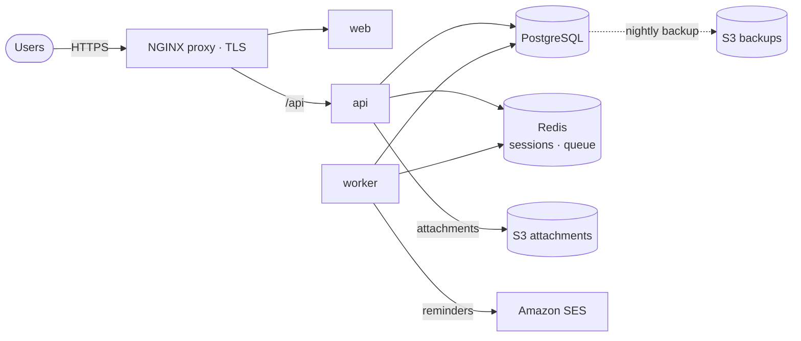

# Tasklane: one product, three ways to production

**Tasklane** is a task-management web app for small teams (React, Express, PostgreSQL, Redis, S3), deployed three ways from the same repository. Each deployment is production-grade at its own budget level and comes with a handover pack: architecture, runbook, rollback steps and cost.

| Tier | Where it runs | Status |
|---|---|---|
| **Single server** | One VM, Docker Compose, NGINX + HTTPS, GitHub Actions CI/CD, nightly backups | ✅ [docs](docs/single-server/) |
| **Managed cloud** | AWS with Terraform: ECS Fargate, RDS, ALB, CloudWatch | Planned |
| **Kubernetes** | GKE: Helm, ArgoCD GitOps, cert-manager, Prometheus/Grafana | Planned |

## The app

A public landing page; accounts with password reset; team workspaces with email invites and owner/member/viewer roles; drag-and-drop boards with custom columns; tasks with assignees, due dates, priorities, labels, checklists, comments with @mentions and file attachments; a per-board activity log; a workspace dashboard with charts; a calendar with drag-to-reschedule; full-text search with filters; in-app notifications with per-user preferences; profile photos; board export to CSV and PDF; and email reminders. Templates, recurring tasks, time tracking and more are being added in phases.

- **web:** React (Vite), served as static files by unprivileged NGINX
- **api:** Express. Accounts with scrypt-hashed passwords and Redis-backed sessions (HttpOnly, SameSite cookies), per-user boards and tasks, file attachments streamed to a private S3 bucket, rate-limited login. `/healthz` (liveness), `/readyz` (checks PostgreSQL and Redis), `/metrics` (Prometheus), structured JSON logs, graceful shutdown
- **worker:** same image, different command. A BullMQ job queue on Redis scans for tasks due soon and sends reminder emails over SMTP (Amazon SES in production), with retries and de-duplication
- **Migrations** run at startup under a PostgreSQL advisory lock, so replicas starting together can't race on a fresh database
- **Tests:** unit tests, plus integration tests in CI against real PostgreSQL and Redis covering sign-up, sessions, rate limiting, per-user isolation, attachments and the reminder queue

## Single-server tier at a glance



- **CI/CD:** every pull request runs lint, tests (including PostgreSQL integration tests), the frontend build, compose validation and shellcheck. Merging to `main` builds both images, pushes them to GHCR, deploys over SSH, health-checks, and **rolls back automatically** if the new version isn't healthy.
- **Infrastructure as code:** Terraform creates the Lightsail VM, static IP, firewall, a versioned private attachments bucket, the backup bucket (14-day lifecycle), the SES sending domain (DKIM), least-privilege IAM users for the app and for backups, and a monthly budget alert.
- **Operations:** Let's Encrypt with auto-renewal, nightly `pg_dump` to S3 with a tested restore script, uptime and certificate-expiry checks every 15 minutes, a hardened host (SSH keys only, fail2ban, ufw, unattended upgrades).

## Repository layout

```
app/
  api/                 Express API, migrations, tests, Dockerfile
  web/                 React frontend, NGINX config, Dockerfile
deploy/
  single-server/       docker-compose, NGINX proxy, scripts, Terraform
.github/workflows/     CI, deploy, uptime check
docs/single-server/    architecture, runbook, cost
compose.dev.yml        local development
```

## Local development

```bash
docker compose -f compose.dev.yml up --build     # PostgreSQL, Redis, MinIO, Mailpit, API (:3000), worker
cd app/web && npm install && npm run dev         # frontend on :5173, proxies /api
cd app/api && npm install && npm test            # unit tests (set DATABASE_URL and REDIS_URL for integration tests)
```

## License

MIT
