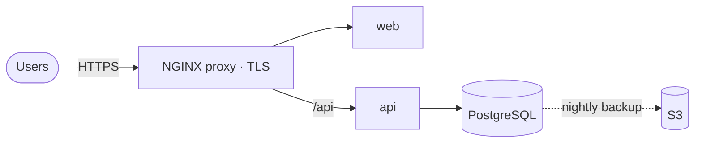

# Taskboard: one app, three ways to production

A small React + Express + PostgreSQL app, deployed three ways from the same repository. Each deployment is production-grade at its own budget level and comes with a handover pack: architecture, runbook, rollback steps and cost.

| Tier | Where it runs | Status |
|---|---|---|
| **Single server** | One VM, Docker Compose, NGINX + HTTPS, GitHub Actions CI/CD, nightly backups | ✅ [docs](docs/single-server/) |
| **Managed cloud** | AWS with Terraform: ECS Fargate, RDS, ALB, CloudWatch | Planned |
| **Kubernetes** | GKE: Helm, ArgoCD GitOps, cert-manager, Prometheus/Grafana | Planned |

## The app

- **web:** React (Vite), served as static files by unprivileged NGINX
- **api:** Express with PostgreSQL. `/healthz` (liveness), `/readyz` (readiness, checks the database), `/metrics` (Prometheus), structured JSON logs, graceful shutdown
- **Migrations** run at startup under a PostgreSQL advisory lock, so replicas starting together can't race on a fresh database
- **Tests:** unit tests for the API, and integration tests against a real PostgreSQL in CI

## Single-server tier at a glance



- **CI/CD:** every pull request runs lint, tests (including PostgreSQL integration tests), the frontend build, compose validation and shellcheck. Merging to `main` builds both images, pushes them to GHCR, deploys over SSH, health-checks, and **rolls back automatically** if the new version isn't healthy.
- **Infrastructure as code:** Terraform creates the Lightsail VM, static IP, firewall, backup bucket (14-day lifecycle), a least-privilege backup user and a monthly budget alert.
- **Operations:** Let's Encrypt with auto-renewal, nightly `pg_dump` to S3 with a tested restore script, uptime and certificate-expiry checks every 15 minutes, a hardened host (SSH keys only, fail2ban, ufw, unattended upgrades).

## Repository layout

```
app/
  api/                 Express API, migrations, tests, Dockerfile
  web/                 React frontend, NGINX config, Dockerfile
deploy/
  single-server/       docker-compose, NGINX proxy, scripts, Terraform
.github/workflows/     CI, deploy, uptime check
docs/single-server/    architecture, runbook, cost
compose.dev.yml        local development
```

## Local development

```bash
docker compose -f compose.dev.yml up --build     # PostgreSQL + API on :3000
cd app/web && npm install && npm run dev         # frontend on :5173, proxies /api
cd app/api && npm install && npm test            # unit tests (set DATABASE_URL for integration tests)
```

## License

MIT
