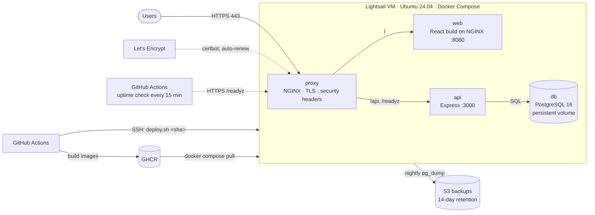

# Single-Server Deployment: Architecture

One Ubuntu 24.04 VM on AWS Lightsail runs the whole stack with Docker Compose. It's the lowest-cost production setup: right for MVPs, internal tools and small businesses.

## Components

| Component | Runs as | Purpose |
|---|---|---|
| proxy | `nginx:1.27-alpine` | Only container with public ports (80, 443). Terminates TLS, serves the ACME challenge, routes `/api` to the API and everything else to the web container. |
| web | `taskboard-web` image | React build served by unprivileged NGINX. No TLS logic, so the same image works behind a Kubernetes ingress. |
| api | `taskboard-api` image | Express API. Runs migrations at start under a PostgreSQL advisory lock, exposes `/healthz`, `/readyz` and `/metrics`. |
| db | `postgres:16-alpine` | Data on a named Docker volume. Not reachable from outside the Docker network. |

## Design decisions

- **Images are built in CI, never on the server.** The server only pulls a tagged image, so every deploy is a known commit and rolling back is just deploying the previous tag.
- **Deploys health-check and roll back automatically.** `deploy.sh` waits for both containers to report healthy and the API to reach the database. If they don't, it redeploys the previous tag and the workflow fails.
- **The proxy re-resolves container names** (`resolver 127.0.0.11`), so recreating the api or web containers on deploy never leaves NGINX pointing at a dead IP.
- **HTTPS bootstraps itself.** The proxy serves only the ACME challenge until a certificate exists, then enables HTTPS on restart. Renewals are certbot's systemd timer plus a deploy hook that restarts the proxy.
- **Uptime is checked from outside.** A scheduled GitHub Actions job checks `/readyz` and certificate expiry from GitHub's network. A monitor on the same VM would go down with it.
- **Backups are tested by restoring them.** `restore.sh latest` pulls the newest dump from S3 and loads it, which is how the backup is verified.

## Security

- SSH: keys only, root login disabled, fail2ban
- Lightsail firewall: 22, 80, 443 only. ufw on the host as a second layer (Docker-published ports bypass ufw, so the Lightsail firewall is the real perimeter).
- Containers run as non-root (api, web). The database has no published port.
- Automatic security updates (unattended-upgrades)
- Backup credentials: a dedicated IAM user limited to one bucket prefix. Database password and keys live only in `/opt/taskboard/.env` on the server.
- HSTS, `X-Content-Type-Options`, `X-Frame-Options` and `Referrer-Policy` headers

## When to move up a tier

Move to [managed cloud (AWS)](../aws/) when you need any of: zero-downtime deploys, a managed database with point-in-time recovery, more than one server, or an uptime commitment. A single VM is a single point of failure, and that's the trade-off for the low cost.
