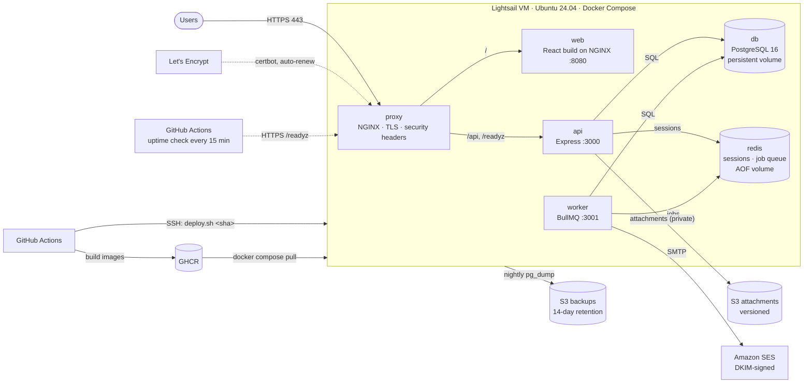

# Single-Server Deployment: Architecture

One Ubuntu 24.04 VM on AWS Lightsail runs the whole stack with Docker Compose. It's the lowest-cost production setup: right for MVPs, internal tools and small businesses.

## Components

| Component | Runs as | Purpose |
|---|---|---|
| proxy | `nginx:1.27-alpine` | Only container with public ports (80, 443). Terminates TLS, serves the ACME challenge, routes `/api` to the API and everything else to the web container. |
| web | `taskboard-web` image | React build served by unprivileged NGINX. No TLS logic, so the same image works behind a Kubernetes ingress. |
| api | `taskboard-api` image | Express API: accounts, boards, tasks, attachments. Runs migrations at start under a PostgreSQL advisory lock, exposes `/healthz`, `/readyz` (PostgreSQL + Redis) and `/metrics`. |
| worker | `taskboard-api` image, `node src/worker.js` | Reminder emails. A scheduled job scans for open tasks due today or tomorrow and queues one email job each; email jobs retry with exponential backoff. Health and metrics on :3001, internal only. |
| db | `postgres:16-alpine` | Users, boards, tasks, attachment metadata. Named Docker volume, no published port. |
| redis | `redis:7-alpine` | Sessions, rate-limit counters and the job queue. Append-only file on a volume so sessions and queued jobs survive restarts; `noeviction` so queue keys are never dropped. No published port. |

## Design decisions

- **Images are built in CI, never on the server.** The server only pulls a tagged image, so every deploy is a known commit and rolling back is just deploying the previous tag.
- **Deploys health-check and roll back automatically.** `deploy.sh` waits for both containers to report healthy and the API to reach the database. If they don't, it redeploys the previous tag and the workflow fails.
- **The proxy re-resolves container names** (`resolver 127.0.0.11`), so recreating the api or web containers on deploy never leaves NGINX pointing at a dead IP.
- **HTTPS bootstraps itself.** The proxy serves only the ACME challenge until a certificate exists, then enables HTTPS on restart. Renewals are certbot's systemd timer plus a deploy hook that restarts the proxy.
- **Uptime is checked from outside.** A scheduled GitHub Actions job checks `/readyz` and certificate expiry from GitHub's network. A monitor on the same VM would go down with it.
- **Backups are tested by restoring them.** `restore.sh latest` pulls the newest dump from S3 and loads it, which is how the backup is verified. A daily **Backup check** workflow fails if the last successful upload is more than 26 hours old, so a broken nightly job can't go unnoticed.
- **One image, two processes.** The worker runs the API image with a different command, so both always deploy together at the same commit and share the data-access code.
- **Attachments go through the API, not presigned URLs.** The API checks the file belongs to the signed-in user, then streams it from a private bucket with `Content-Disposition: attachment`, so an uploaded HTML or SVG file can never run as a page on the site.
- **Reminders are at-least-once.** Each email job re-checks the task right before sending (still open, same due date, not yet reminded). Job ids include the due date, so repeated scans don't queue duplicates and a new due date earns a new reminder.
- **What is backed up where.** PostgreSQL: nightly dumps to S3. Attachments: S3 versioning keeps deleted or replaced files for 30 days. Redis holds only sessions and queued jobs; losing it signs people out and the next scan re-queues any reminders, so it isn't backed up.

## Security

- SSH: keys only, root login disabled, fail2ban
- Lightsail firewall: 22, 80, 443 only. ufw on the host as a second layer (Docker-published ports bypass ufw, so the Lightsail firewall is the real perimeter).
- Containers run as non-root (api, web). The database has no published port.
- Automatic security updates (unattended-upgrades)
- Passwords hashed with scrypt; unknown emails take as long to reject as wrong passwords. Login is rate-limited per email (10 per 15 minutes) and sign-up per IP.
- Sessions: random 256-bit tokens in HttpOnly, Secure, SameSite=Lax cookies. Redis stores only a SHA-256 of each token. SameSite=Lax is the CSRF protection.
- Every query is scoped to the signed-in user; integration tests check that one user gets 404 on another user's boards, tasks and files.
- IAM: the app user can only read/write/delete objects under `attachments/` in its bucket and send email from the app's domain. The backup user can only read/write the backup prefix. Secrets live only in `/opt/taskboard/.env` on the server.
- Email: the sending domain is verified in SES with DKIM.
- HSTS, `X-Content-Type-Options`, `X-Frame-Options` and `Referrer-Policy` headers

## When to move up a tier

Move to [managed cloud (AWS)](../aws/) when you need any of: zero-downtime deploys, a managed database with point-in-time recovery, more than one server, or an uptime commitment. A single VM is a single point of failure, and that's the trade-off for the low cost.
